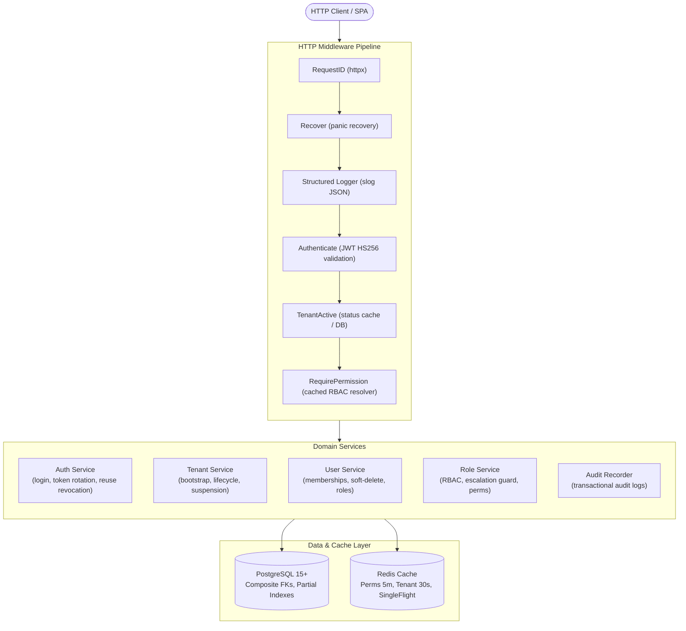

# Multi-Tenant User Management System (Go + PostgreSQL + Redis)

A multi-tenant user management backend platform designed for security, strict tenant isolation, and horizontal scalability.

Built in Go 1.22+ using pure PostgreSQL (jackc/pgx/v5 connection pool, handwritten SQL, no ORM), Redis shared cache, and `go-chi/chi/v5`.

---

## 1. Architecture Overview

The system implements clean 3-layer architecture (`Handler → Service → Repository`) per domain, with strict layer isolation and interfaces for complete unit testability.



---

## 2. Tech Stack

| Component | Technology | Rationale |
|---|---|---|
| **Language** | Go 1.22+ | Statically typed, high throughput, low memory footprint |
| **HTTP Router** | `go-chi/chi/v5` | Lightweight, 100% `net/http` compatible, idiomatic middleware |
| **Database Pool** | `jackc/pgx/v5/pgxpool` | High-performance PostgreSQL native driver with connection pooling (no ORM) |
| **Migrations** | `golang-migrate/migrate` | Versioned, bidirectional SQL migrations (`migrations/000001` .. `000007`) |
| **Authentication** | `golang-jwt/jwt/v5` | HS256 JWT access tokens + family-tracked refresh tokens |
| **Password Hashing** | `golang.org/x/crypto/bcrypt` | Configurable cost (default 12, 4 in test) with dummy hash timing protection |
| **Validation** | `go-playground/validator/v10` | Struct validation with custom `password_policy` |
| **Caching** | Interface `cache.Cache` | Redis (`go-redis/v9`) with in-memory fallback + singleflight stampede guard |
| **Structured Logs** | `log/slog` | Correlated JSON logging with `request_id`, `tenant_id`, and `actor_id` |

---

## 3. Key Decisions & Security Model

1. **Strict Tenant Isolation (404 Not Found):**
   - Attempting to access another tenant's resource returns `404 Not Found` (never `403` or `200`). Foreign resource IDs are indistinguishable from nonexistent IDs to prevent probing.
2. **Stateless JWT Claims & Token-Only Context:**
   - The active tenant ID is extracted exclusively from the cryptographically verified JWT `tid` claim.
   - Request bodies attempting to inject `tenant_id` are strictly rejected with `400 Bad Request` (`UNKNOWN_FIELD`).
3. **Physical Isolation via Composite Foreign Keys:**
   - `user_roles` references `(tenant_id, user_id)` and `(tenant_id, role_id)`.
   - `role_permissions` references `(tenant_id, role_id)`.
   - Even if application code errs, cross-tenant role assignment is physically prevented by the PostgreSQL engine.
4. **Token Rotation & Family Reuse Detection:**
   - Refresh tokens are tracked in families. If an already-rotated token is replayed, the entire family is revoked immediately, and an audit event is recorded.
5. **Privilege Escalation Guard:**
   - An administrator cannot assign roles or permissions that they do not personally possess.
6. **Immutable System Roles:**
   - Seeded system roles (`platform_admin`, `tenant_admin`, `user_manager`, `viewer`) cannot be modified or deleted.

---

## 4. Quickstart

### Prerequisites
- Docker & Docker Compose
- Go 1.22+ (if running locally without Docker)
- Make (optional)

### Option A: Run via Docker Compose (Recommended)

1. Clone and enter the repository:
   ```bash
   git clone git@github.com:aalekh12/multi-tenant-ums.git
   cd multi-tenant-ums
   ```

2. Start PostgreSQL, Redis, and run migrations:
   ```bash
   docker compose up -d postgres redis
   ```

3. Seed demo data:
   ```bash
   go run ./cmd/seed
   ```

4. Run the API:
   ```bash
   docker compose up -d api
   ```
   Or run the API directly on your host:
   ```bash
   go run ./cmd/api
   ```

The API will be available at `http://localhost:8080`.

---

## 5. Seed Credentials Table

The database seed tool (`cmd/seed/main.go`) creates the following accounts with default password `ChangeMe!12345`:

| Tenant Code | Tenant Name | User Email | Assigned Role | Capabilities / Purpose |
|---|---|---|---|---|
| `platform` | Platform Admin | `root@platform.test` | `platform_admin` | Global platform administrator: can create, list, suspend, and activate tenants |
| `acme` | Acme Corp | `admin@acme.test` | `tenant_admin` | Full administrator of Acme Corp |
| `acme` | Acme Corp | `manager@acme.test` | `user_manager` | Can manage users and memberships |
| `acme` | Acme Corp | `viewer@acme.test` | `viewer` | Read-only access to users, roles, and tenant profile |
| `acme` | Acme Corp | `user01@acme.test` .. `user50@acme.test` | `viewer` | 50 filler users for pagination testing |
| `globex` | Globex Corporation | `admin@globex.test` | `tenant_admin` | Full administrator of Globex Corporation |
| **Multi-Tenant** | Both | `shared@example.test` | `viewer` (in Acme)<br>`tenant_admin` (in Globex) | Cross-tenant user demonstrating context switching via `/auth/switch-tenant` |

---

## 6. End-to-End Walkthrough via cURL

### Step 1: Healthcheck
```bash
curl -i http://localhost:8080/healthz
curl -i http://localhost:8080/readyz
```

### Step 2: Login as Platform Admin & List Tenants
```bash
# Login to platform tenant
LOGIN_RESP=$(curl -s -X POST http://localhost:8080/api/v1/auth/login \
  -H "Content-Type: application/json" \
  -d '{"email":"root@platform.test","password":"ChangeMe!12345","tenant_code":"platform"}')

ROOT_TOKEN=$(echo $LOGIN_RESP | grep -o '"access_token":"[^"]*' | cut -d'"' -f4)

# List all tenants
curl -i -H "Authorization: Bearer $ROOT_TOKEN" http://localhost:8080/api/v1/tenants
```

### Step 3: Login as Acme Admin & Create a User
```bash
# Login to Acme Corp
ACME_RESP=$(curl -s -X POST http://localhost:8080/api/v1/auth/login \
  -H "Content-Type: application/json" \
  -d '{"email":"admin@acme.test","password":"ChangeMe!12345","tenant_code":"acme"}')

ACME_TOKEN=$(echo $ACME_RESP | grep -o '"access_token":"[^"]*' | cut -d'"' -f4)

# Create a new user in Acme
CREATE_USER_RESP=$(curl -s -X POST http://localhost:8080/api/v1/users \
  -H "Authorization: Bearer $ACME_TOKEN" \
  -H "Content-Type: application/json" \
  -d '{"email":"alice@acme.test","full_name":"Alice Engineer","password":"ChangeMe!12345"}')

echo $CREATE_USER_RESP
USER_ID=$(echo $CREATE_USER_RESP | grep -o '"id":"[^"]*' | head -1 | cut -d'"' -f4)
```

### Step 4: Login as Multi-Tenant User (`shared@example.test`)
```bash
# Login to Acme context
SHARED_RESP=$(curl -s -X POST http://localhost:8080/api/v1/auth/login \
  -H "Content-Type: application/json" \
  -d '{"email":"shared@example.test","password":"ChangeMe!12345","tenant_code":"acme"}')

SHARED_TOKEN=$(echo $SHARED_RESP | grep -o '"access_token":"[^"]*' | cut -d'"' -f4)

# Inspect permissions in Acme (viewer only: user:read, role:read, etc.)
curl -s -H "Authorization: Bearer $SHARED_TOKEN" http://localhost:8080/api/v1/auth/me
```

### Step 5: Switch Tenant to Globex
```bash
# Fetch Globex tenant ID from tenant listing or database
# Switch context
SWITCH_RESP=$(curl -s -X POST http://localhost:8080/api/v1/auth/switch-tenant \
  -H "Authorization: Bearer $SHARED_TOKEN" \
  -H "Content-Type: application/json" \
  -d '{"target_tenant_id":"<globex-tenant-id>"}')

GLOBEX_TOKEN=$(echo $SWITCH_RESP | grep -o '"access_token":"[^"]*' | cut -d'"' -f4)

# Inspect permissions in Globex (tenant_admin: full control)
curl -s -H "Authorization: Bearer $GLOBEX_TOKEN" http://localhost:8080/api/v1/auth/me
```

### Step 6: Verify Strict Tenant Isolation (Cross-Tenant Access Returns 404)
```bash
# Attempt to read Acme's user using Globex token -> Returns 404 Not Found!
curl -i -H "Authorization: Bearer $GLOBEX_TOKEN" http://localhost:8080/api/v1/users/$USER_ID
```
*Response: `HTTP/1.1 404 Not Found` with `{ "error": { "code": "NOT_FOUND", "message": "user not found" } }`.*

### Step 7: Verify RBAC Permission Guard (Viewer Cannot Mutate)
```bash
# Login as Acme viewer
VIEWER_RESP=$(curl -s -X POST http://localhost:8080/api/v1/auth/login \
  -H "Content-Type: application/json" \
  -d '{"email":"viewer@acme.test","password":"ChangeMe!12345","tenant_code":"acme"}')

VIEWER_TOKEN=$(echo $VIEWER_RESP | grep -o '"access_token":"[^"]*' | cut -d'"' -f4)

# Attempt to delete user -> Returns 403 Forbidden!
curl -i -X DELETE -H "Authorization: Bearer $VIEWER_TOKEN" http://localhost:8080/api/v1/users/$USER_ID
```
*Response: `HTTP/1.1 403 Forbidden` with `{ "error": { "code": "FORBIDDEN", "details": [{"issue": "requires user:delete"}] } }`.*

### Step 8: Query Keyset-Paginated Audit Logs
```bash
curl -i -H "Authorization: Bearer $ACME_TOKEN" "http://localhost:8080/api/v1/audit-logs?limit=10"
```

---

## 7. Performance & Scalability Strategy

1. **Composite & Partial Indexes:**
   - Every tenant-scoped query filters on `tenant_id` and leverages partial indexes with `WHERE deleted_at IS NULL`.
   - Composite keys on `(tenant_id, created_at DESC, user_id)` ensure index-only scans for high-volume pagination.
2. **SingleFlight Permission Resolver:**
   - Permission codes for `(tenant_id, user_id)` are cached in Redis with a 5-minute TTL.
   - High-concurrency requests for the same user share a single in-flight DB lookup via `golang.org/x/sync/singleflight`, completely eliminating cache stampedes.
3. **Tenant Suspension Fast-Path:**
   - Operational status (`active` vs `suspended`) is cached for 30 seconds.
   - Suspended tenants fail immediately at the `TenantActive` middleware layer without loading downstream domain objects.
4. **Keyset (Cursor) Pagination for Audit Logs:**
   - Audit logs utilize `(created_at, id)` keyset pagination, maintaining O(1) performance regardless of table depth (unlike traditional `OFFSET/LIMIT`).

---

## 8. Testing Suite

The repository contains extensive unit and integration test coverage:

```bash
# Run all unit tests
go test ./internal/...

# Run integration tests (cross-tenant isolation matrix, unknown body rejection, malformed UUID probing)
go test -v ./test/integration

# Run entire suite with race detection
go test -race ./...
```

---

## 9. API Documentation & Artifacts

- **Interactive Swagger UI:** Served locally at [`http://localhost:8080/swagger/index.html`](http://localhost:8080/swagger/index.html).
- **OpenAPI 3.0 Specification:** Stored at [`docs/openapi.yaml`](https://github.com/aalekh12/multi-tenant-ums/blob/master/docs/openapi.yaml).
- **Postman Collection:** Stored at [`docs/postman_collection.json`](https://github.com/aalekh12/multi-tenant-ums/blob/master/docs/postman_collection.json).
- **Architecture Design Document:** Read [`docs/DESIGN.md`]([file:///docs/DESIGN.md](https://github.com/aalekh12/multi-tenant-ums/blob/master/docs/DESIGN.md)) for full architectural trade-offs.
- **Database ER Diagram:** [Visual Diagram](https://github.com/aalekh12/multi-tenant-ums/blob/master/docs/multi_tenant_database_erd.jpg) 
- **SQL Relationship Documentation**  [`docs/er-diagram.md`](https://github.com/aalekh12/multi-tenant-ums/blob/master/docs/er-diagram.md).

