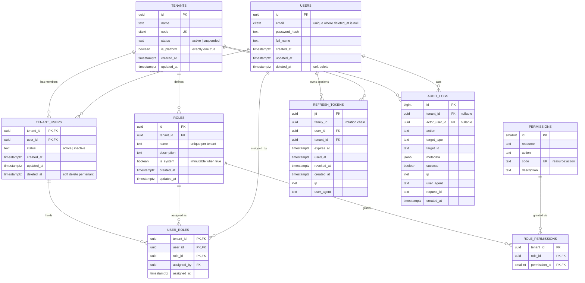

# Database ER Diagram

Shared database, shared schema. Tenant-owned tables carry `tenant_id`; `users` and `permissions` are global.

## Notes on keys and constraints

- **Many-to-many users and tenants** is resolved by `tenant_users` (composite PK `tenant_id, user_id`).
- **Composite foreign keys enforce isolation in the database.**
  - `user_roles (tenant_id, user_id)` references `tenant_users (tenant_id, user_id)`.
  - `user_roles (tenant_id, role_id)` references `roles (tenant_id, id)`.
  - `role_permissions (tenant_id, role_id)` references `roles (tenant_id, id)`.
  - A role from tenant B therefore cannot be linked to a user in tenant A, even if application code has a bug.
- **Soft delete:** `users.deleted_at` is set only when a user has no active memberships left. `tenant_users.deleted_at` is the per-tenant removal.
- **Uniqueness:**
  - `tenants.code` is globally unique.
  - `users.email` is unique among non-deleted rows (partial index).
  - `roles (tenant_id, name)` is unique.
  - `permissions.code` is unique.
  - Only one tenant may have `is_platform = true`.
- **Key indexes:**
  - `tenant_users (tenant_id, created_at DESC, user_id) WHERE deleted_at IS NULL` for user lists.
  - `user_roles (tenant_id, role_id)` for role-member lookups.
  - `audit_logs (tenant_id, created_at DESC, id DESC)` for keyset pagination.
  - `refresh_tokens (family_id)` for reuse-detection revocation.
